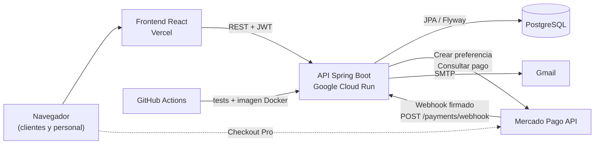
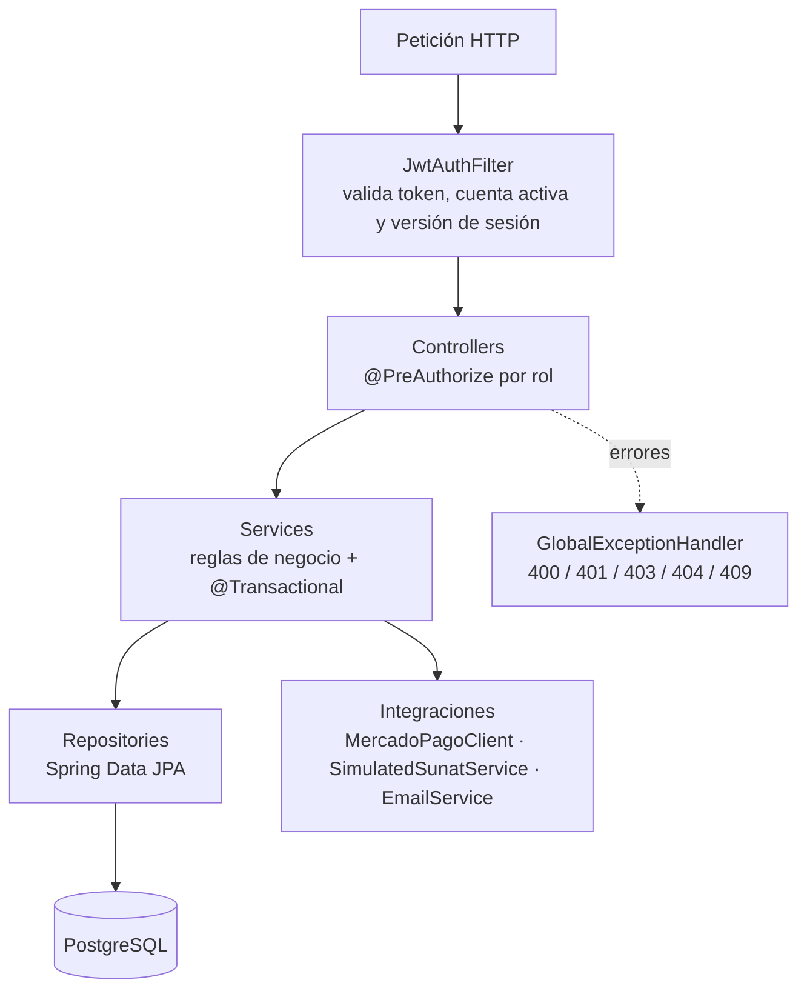
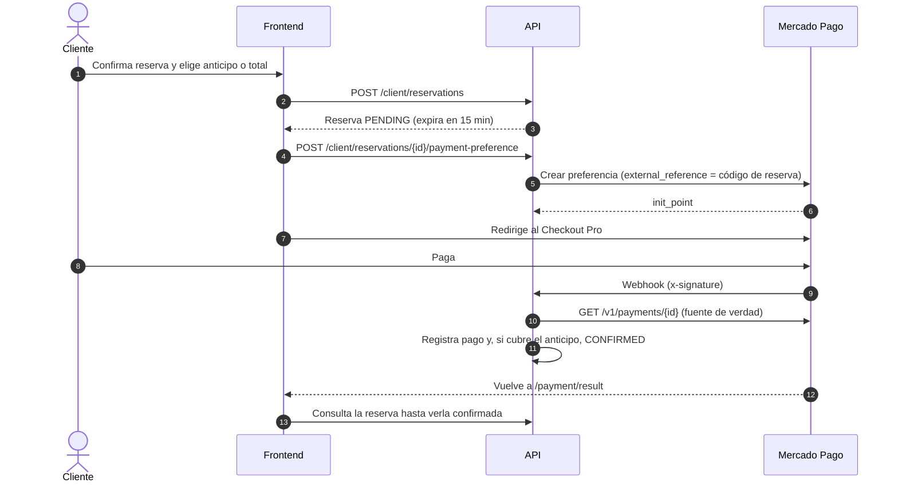
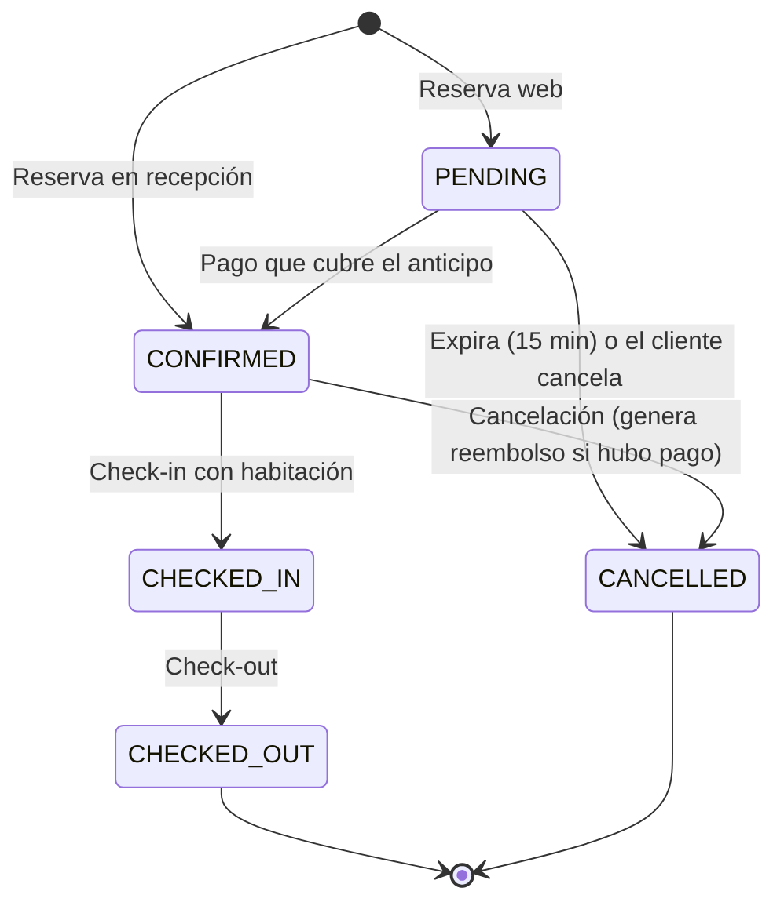
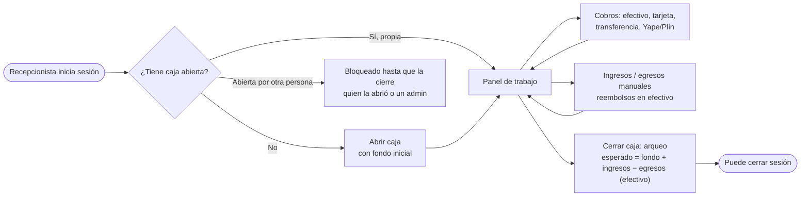
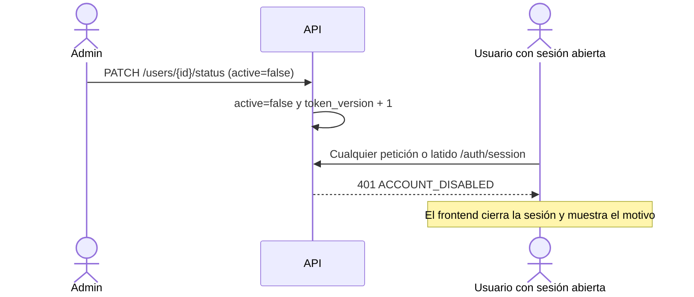
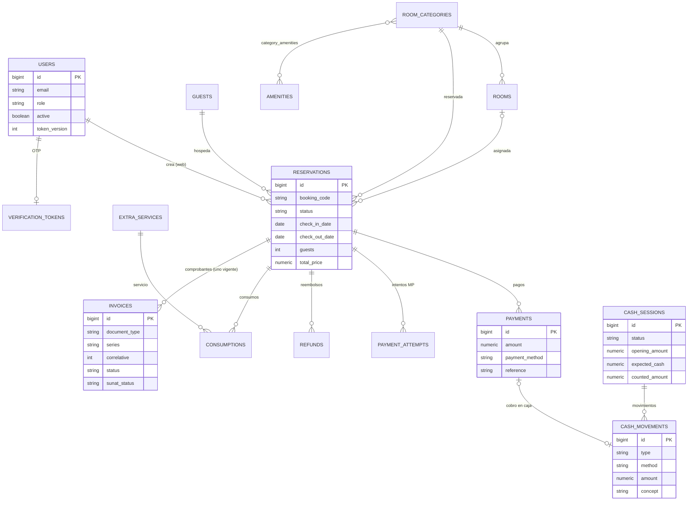
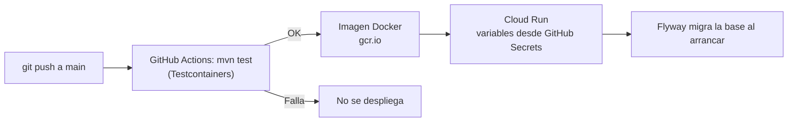

# Hotel Gotitas · Backend

API REST del sistema de gestión de **Hotel Gotitas** (una sola sede): reservas web y en recepción, pagos con
Mercado Pago, caja de recepción, facturación electrónica simulada y panel administrativo.

> Frontend: [HotelGotitass/Hotel-frontend](https://github.com/HotelGotitass/Hotel-frontend)

## Contenido

- [Stack](#stack) · [Arquitectura](#arquitectura) · [Funcionalidades](#funcionalidades) · [Flujos](#flujos)
- [Modelo de datos](#modelo-de-datos) · [Variables de entorno](#variables-de-entorno) · [Ejecutar en local](#ejecutar-en-local)
- [Tests](#tests) · [API](#api) · [Migraciones](#migraciones) · [Despliegue](#despliegue)

## Stack

- Java 21 · Spring Boot 3.2 (Web, Security, Data JPA, Validation, Mail)
- PostgreSQL · Flyway · JWT (jjwt) · BCrypt
- OpenPDF + ZXing (comprobantes PDF con QR) · Testcontainers (tests)

## Arquitectura



Organización interna por capas:



## Funcionalidades

| Módulo | Qué hace |
|---|---|
| **Reservas** | Disponibilidad por fechas y huéspedes, reserva web (15 min para pagar) y en recepción, check-in/out, consumos, cambio de fechas y cancelación con solicitud de reembolso. |
| **Mercado Pago** | Checkout Pro: anticipo (50 %), total o saldo. Webhook con firma `x-signature`; estado y monto se confirman en la API de Mercado Pago; pagos duplicados se registran una vez. |
| **Caja** | Apertura con fondo (una caja abierta a la vez), cobros por medio de pago, ingresos/egresos, reembolsos en efectivo como egreso y cierre con arqueo. |
| **Facturación simulada** | Boleta `B001` / factura `F001`, validación de RUC/DNI, IGV 18 %, importe en letras, QR formato SUNAT y nota de crédito. **Sin conexión a SUNAT ni OSE/PSE.** |
| **Cuentas** | Roles `ADMIN`, `RECEPCIONISTA`, `CLIENT`; cambio y restablecimiento de contraseña; deshabilitar cuentas invalida sus sesiones al instante. |
| **Catálogo** | Categorías con comodidades, habitaciones, servicios extra, huéspedes, reclamaciones y dashboard. |

## Flujos

### Pago con Mercado Pago



### Estados de una reserva



### Caja de recepción



### Deshabilitar una cuenta



## Modelo de datos



## Variables de entorno

Toda la configuración sensible se lee de variables de entorno; **no hay credenciales en el repositorio**.
Plantilla: [`.env.example`](.env.example) (los `.env` reales están en `.gitignore`).

<!-- AUTO-GENERATED: variables de entorno (fuente: .env.example) - no editar a mano; regenerar desde el codigo -->
| Variable | Obligatoria | Descripción |
|---|---|---|
| `DB_URL` | Sí | JDBC de PostgreSQL |
| `DB_USERNAME` | Sí | Usuario de la base |
| `DB_PASSWORD` | Sí | Contraseña de la base |
| `JWT_SECRET` | Sí | Clave HMAC en Base64 (mín. 32 bytes): `openssl rand -base64 48` |
| `JWT_EXPIRATION` | Sí | Vigencia del token en ms |
| `CORS_ALLOWED_ORIGINS` | Sí | Orígenes del frontend, separados por coma |
| `MAIL_USERNAME` | Sí | Cuenta SMTP (Gmail) |
| `MAIL_PASSWORD` | Sí | Contraseña de aplicación de Gmail |
| `MP_ACCESS_TOKEN` | No | Access token de Mercado Pago (`TEST-...` en sandbox); sin él no se crean pagos |
| `MP_WEBHOOK_SECRET` | No | Clave de webhooks de Mercado Pago (valida `x-signature`) |
| `FRONTEND_URL` | Sí | URL pública del frontend (retorno de Mercado Pago) |
| `BACKEND_URL` | Sí | URL pública **https** del backend (Mercado Pago solo notifica a https) |
| `BILLING_RUC` | No | RUC del emisor en comprobantes simulados |
| `BILLING_NAME` | No | Razón social del emisor |
| `BILLING_ADDRESS` | No | Dirección fiscal del emisor |
| `PORT` | No | Puerto HTTP (por defecto `8080`) |
<!-- /AUTO-GENERATED -->

## Ejecutar en local

Requisitos: **Java 21** y **Docker**.

```bash
# 1. Base de datos local
docker run -d --name hotel-db -e POSTGRES_PASSWORD=postgres -e POSTGRES_DB=hotel -p 5432:5432 postgres:16-alpine

# 2. Variables (ver .env.example) y arranque; Flyway crea el esquema
export DB_URL=jdbc:postgresql://localhost:5432/hotel DB_USERNAME=postgres DB_PASSWORD=postgres
export JWT_SECRET=$(openssl rand -base64 48) JWT_EXPIRATION=86400000
export CORS_ALLOWED_ORIGINS=http://localhost:5173 MAIL_USERNAME=... MAIL_PASSWORD=...
./mvnw spring-boot:run
```

**Primer administrador:** no se crea automáticamente. Genera el hash y, con la base ya migrada, insértalo:

```bash
./mvnw -q compile
java -cp "target/classes:$(./mvnw -q dependency:build-classpath -Dmdep.outputFile=/dev/stdout)" com.hotel.app.HashGen "TuContraseñaSegura"
# INSERT INTO users (email, password, role, is_verified, active, token_version, created_at)
# VALUES ('admin@tuhotel.com', '<hash>', 'ADMIN', true, true, 0, now());
```

Para recibir webhooks de Mercado Pago en local, expón el backend por https (p. ej. `ngrok http 8080`) y usa esa URL en `BACKEND_URL`.

## Tests

```bash
./mvnw test
```

Los tests de integración levantan su **propia PostgreSQL en Docker** (Testcontainers); nunca usan una base real
ni envían correos. Requiere Docker en ejecución.

## API

Base `/api/v1`. Endpoints sin rol explícito requieren sesión iniciada (cualquier rol).

<!-- AUTO-GENERATED: referencia de endpoints (fuente: controllers @RequestMapping/@PreAuthorize + SecurityConfig) - no editar a mano; regenerar desde el codigo -->
| Método | Ruta | Acceso | Módulo |
|---|---|---|---|
| `GET` | `/api/v1/account/me` | ADMIN, RECEPCIONISTA | Account |
| `PATCH` | `/api/v1/account/password` | ADMIN, RECEPCIONISTA | Account |
| `GET` | `/api/v1/admin/refunds` | ADMIN, RECEPCIONISTA | AdminRefund |
| `POST` | `/api/v1/admin/refunds/{id}/process` | ADMIN, RECEPCIONISTA | AdminRefund |
| `GET` | `/api/v1/amenities` | Autenticado | Amenity |
| `POST` | `/api/v1/amenities` | ADMIN | Amenity |
| `POST` | `/api/v1/auth/login` | Público | Auth |
| `GET` | `/api/v1/auth/session` | Autenticado | Auth |
| `POST` | `/api/v1/auth/register` | ADMIN | Auth |
| `GET` | `/api/v1/cash/current` | ADMIN, RECEPCIONISTA | Cash |
| `POST` | `/api/v1/cash/open` | ADMIN, RECEPCIONISTA | Cash |
| `POST` | `/api/v1/cash/movements` | ADMIN, RECEPCIONISTA | Cash |
| `POST` | `/api/v1/cash/close` | ADMIN, RECEPCIONISTA | Cash |
| `GET` | `/api/v1/cash/sessions` | ADMIN, RECEPCIONISTA | Cash |
| `GET` | `/api/v1/cash/sessions/{id}` | ADMIN, RECEPCIONISTA | Cash |
| `POST` | `/api/v1/client/auth/register` | Público | ClientAuth |
| `POST` | `/api/v1/client/auth/verify` | Público | ClientAuth |
| `POST` | `/api/v1/client/auth/forgot-password` | Público | ClientPasswordReset |
| `POST` | `/api/v1/client/auth/reset-password` | Público | ClientPasswordReset |
| `PUT` | `/api/v1/client/profile` | Autenticado | ClientProfile |
| `POST` | `/api/v1/client/profile/password-request` | Autenticado | ClientProfile |
| `POST` | `/api/v1/client/profile/password-change` | Autenticado | ClientProfile |
| `POST` | `/api/v1/client/reservations` | CLIENT | ClientReservation |
| `GET` | `/api/v1/client/reservations` | CLIENT | ClientReservation |
| `POST` | `/api/v1/client/reservations/{id}/cancel` | CLIENT | ClientReservation |
| `PATCH` | `/api/v1/client/reservations/{id}/dates` | CLIENT | ClientReservation |
| `POST` | `/api/v1/client/reservations/{id}/payment-preference` | CLIENT | ClientReservation |
| `GET` | `/api/v1/client/reservations/{id}/invoice/pdf` | CLIENT | ClientReservation |
| `POST` | `/api/v1/complaints` | Público | Complaint |
| `GET` | `/api/v1/complaints` | ADMIN, RECEPCIONISTA | Complaint |
| `PATCH` | `/api/v1/complaints/{id}/status` | ADMIN, RECEPCIONISTA | Complaint |
| `POST` | `/api/v1/consumptions` | ADMIN, RECEPCIONISTA | Consumption |
| `GET` | `/api/v1/consumptions/reservation/{reservationId}` | ADMIN, RECEPCIONISTA | Consumption |
| `DELETE` | `/api/v1/consumptions/{id}` | ADMIN | Consumption |
| `GET` | `/api/v1/dashboard` | ADMIN, RECEPCIONISTA | Dashboard |
| `POST` | `/api/v1/services` | ADMIN | ExtraService |
| `PUT` | `/api/v1/services/{id}` | ADMIN | ExtraService |
| `GET` | `/api/v1/services` | ADMIN, RECEPCIONISTA | ExtraService |
| `POST` | `/api/v1/guests` | ADMIN, RECEPCIONISTA | Guest |
| `GET` | `/api/v1/guests/{id}` | ADMIN, RECEPCIONISTA | Guest |
| `GET` | `/api/v1/guests` | ADMIN, RECEPCIONISTA | Guest |
| `PUT` | `/api/v1/guests/{id}` | ADMIN, RECEPCIONISTA | Guest |
| `POST` | `/api/v1/invoices/reservation/{reservationId}` | ADMIN, RECEPCIONISTA | Invoice |
| `GET` | `/api/v1/invoices/reservation/{reservationId}` | ADMIN, RECEPCIONISTA | Invoice |
| `GET` | `/api/v1/invoices` | ADMIN, RECEPCIONISTA | Invoice |
| `PATCH` | `/api/v1/invoices/{id}/void` | ADMIN, RECEPCIONISTA | Invoice |
| `PATCH` | `/api/v1/invoices/{id}/pay` | ADMIN, RECEPCIONISTA | Invoice |
| `GET` | `/api/v1/invoices/{id}/pdf` | ADMIN, RECEPCIONISTA | Invoice |
| `GET` | `/api/v1/public/search` | Público | PublicSearch |
| `GET` | `/api/v1/rooms/search` | Público | Reservation |
| `POST` | `/api/v1/reservations` | ADMIN, RECEPCIONISTA | Reservation |
| `GET` | `/api/v1/reservations` | ADMIN, RECEPCIONISTA | Reservation |
| `PATCH` | `/api/v1/reservations/{id}/checkin` | ADMIN, RECEPCIONISTA | Reservation |
| `PATCH` | `/api/v1/reservations/{id}/checkout` | ADMIN, RECEPCIONISTA | Reservation |
| `PATCH` | `/api/v1/reservations/{id}/cancel` | ADMIN, RECEPCIONISTA | Reservation |
| `POST` | `/api/v1/reservations/{id}/payments` | ADMIN, RECEPCIONISTA | Reservation |
| `GET` | `/api/v1/reservations/{id}/payments` | ADMIN, RECEPCIONISTA | Reservation |
| `GET` | `/api/v1/reservations/code/{bookingCode}` | ADMIN, RECEPCIONISTA | Reservation |
| `POST` | `/api/v1/categories` | ADMIN | RoomCategory |
| `POST` | `/api/v1/categories/{id}/image` | ADMIN | RoomCategory |
| `PUT` | `/api/v1/categories/{id}` | ADMIN | RoomCategory |
| `DELETE` | `/api/v1/categories/{id}` | ADMIN | RoomCategory |
| `GET` | `/api/v1/categories/{id}` | Público | RoomCategory |
| `GET` | `/api/v1/categories` | Público | RoomCategory |
| `POST` | `/api/v1/rooms` | ADMIN | Room |
| `PUT` | `/api/v1/rooms/{id}` | ADMIN | Room |
| `DELETE` | `/api/v1/rooms/{id}` | ADMIN | Room |
| `GET` | `/api/v1/rooms/{id}` | Autenticado | Room |
| `GET` | `/api/v1/rooms` | Autenticado | Room |
| `PATCH` | `/api/v1/rooms/{id}/status` | ADMIN | Room |
| `GET` | `/api/v1/users` | ADMIN | User |
| `GET` | `/api/v1/users/clients` | ADMIN | User |
| `PATCH` | `/api/v1/users/{id}/status` | ADMIN | User |
| `POST` | `/api/v1/users` | ADMIN | User |
| `PUT` | `/api/v1/users/{id}` | ADMIN | User |
| `PATCH` | `/api/v1/users/{id}/password` | ADMIN | User |
| `DELETE` | `/api/v1/users/{id}` | ADMIN | User |
| `POST` | `/api/v1/payments/webhook` | Público (firma Mercado Pago) | WebhookPayment |
<!-- /AUTO-GENERATED -->

## Migraciones

Flyway las aplica automáticamente al arrancar.

<!-- AUTO-GENERATED: migraciones (fuente: src/main/resources/db/migration) - no editar a mano; regenerar desde el codigo -->
| Versión | Migración |
|---|---|
| V1 | init |
| V2 | add reservation fields |
| V3 | verification tokens |
| V4 | add expires at to reservations |
| V5 | add user id to reservations |
| V6 | add payment attempts |
| V7 | add payments |
| V8 | add cancellation fields |
| V9 | add refunds |
| V10 | add translation fields |
| V11 | remove translation fields |
| V12 | update users role check |
| V13 | add purpose to verification tokens |
| V14 | add complaints |
| V15 | mercadopago payments |
| V16 | simulated electronic invoicing |
| V17 | cash register and guests |
| V18 | account status and sessions |
| V19 | refund method |
<!-- /AUTO-GENERATED -->

## Despliegue



## Licencia

Apache 2.0 — ver [LICENSE](LICENSE).
