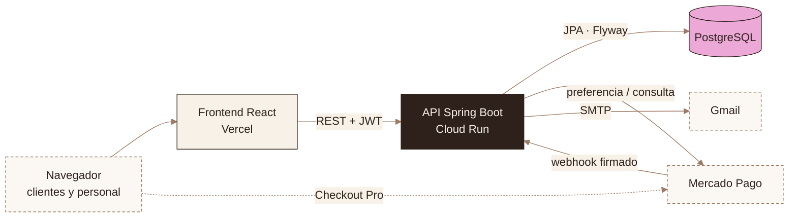
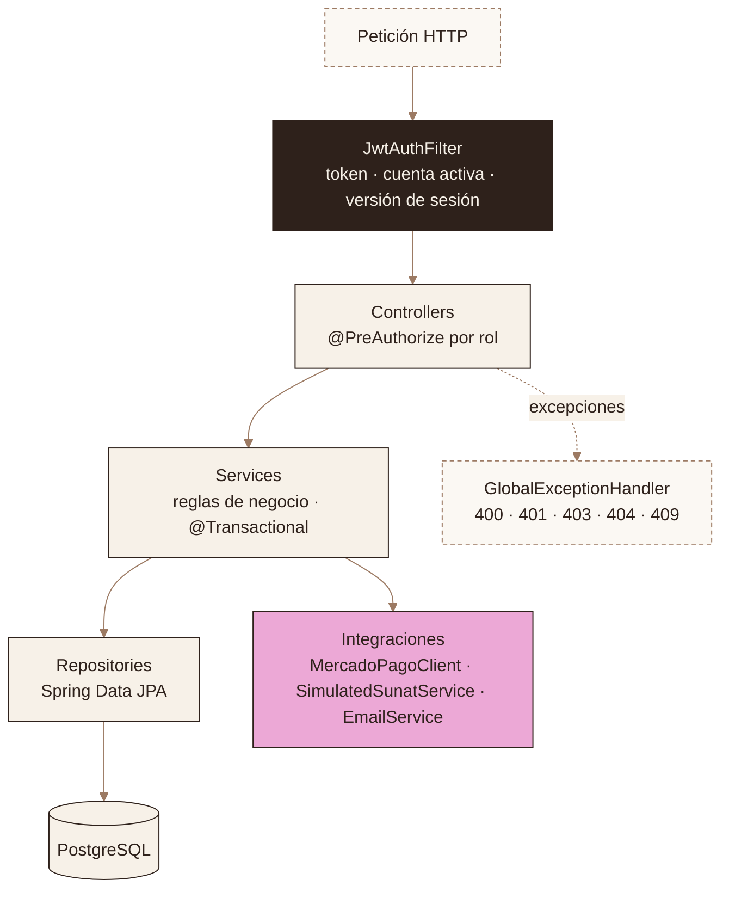
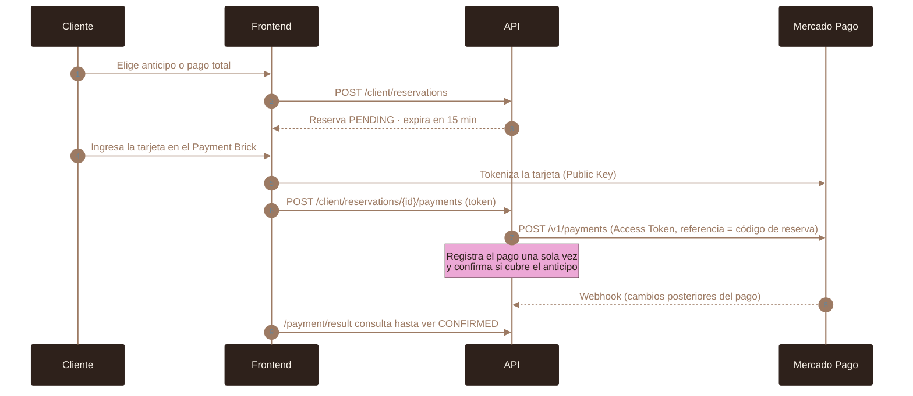
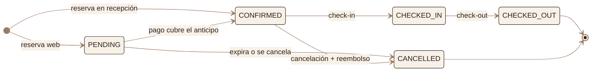
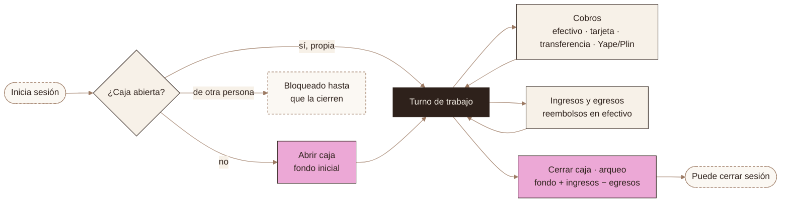
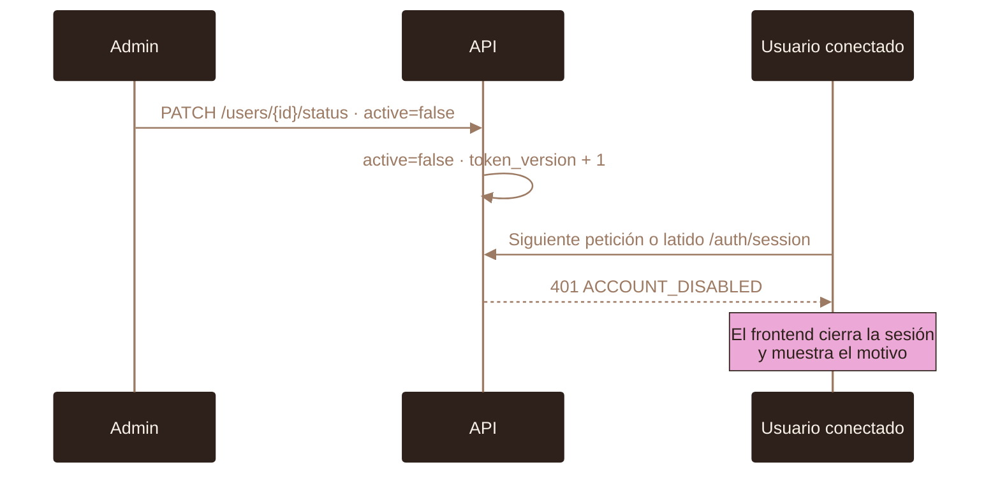
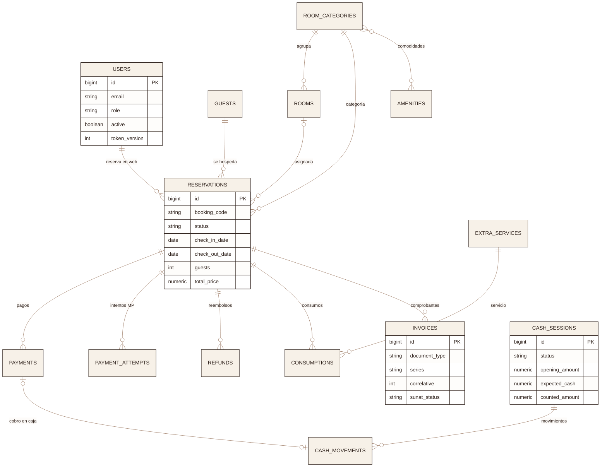
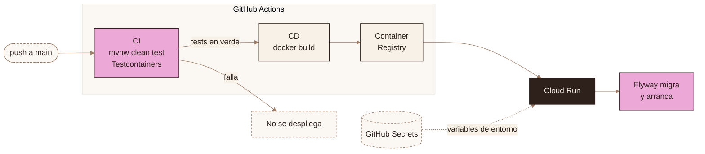

<div align="center">

<h1>Hotel Gotitas · API</h1>

<p><b>Backend del sistema de gestión hotelera</b><br>
reservas · pagos con Mercado Pago · caja de recepción · facturación simulada</p>

<a href="https://github.com/HotelGotitass/Hotel/actions/workflows/deploy-backend.yml"></a>      

<p>
<a href="#arquitectura">Arquitectura</a> ·
<a href="#flujos">Flujos</a> ·
<a href="#inicio-rápido">Inicio rápido</a> ·
<a href="#configuración">Configuración</a> ·
<a href="#api">API</a> ·
<a href="#cicd">CI/CD</a> ·
<a href="https://github.com/HotelGotitass/Hotel-frontend">Frontend ↗</a>
</p>

</div>

---

## En un vistazo

<table>
<tr>
<td width="33%" valign="top"><b>Reservas</b><br><sub>Disponibilidad por fechas y huéspedes, reserva web con 15 min para pagar, recepción, check-in/out, consumos y cambio de fechas.</sub></td>
<td width="33%" valign="top"><b>Mercado Pago</b><br><sub>Checkout Pro con anticipo (50 %), total o saldo. Webhook firmado e idempotente.</sub></td>
<td width="33%" valign="top"><b>Caja</b><br><sub>Apertura con fondo, cobros por medio de pago, ingresos/egresos y cierre con arqueo. Una caja abierta a la vez.</sub></td>
</tr>
<tr>
<td width="33%" valign="top"><b>Facturación simulada</b><br><sub>Boleta B001 / factura F001, RUC/DNI validados, IGV, importe en letras, QR y nota de crédito.</sub></td>
<td width="33%" valign="top"><b>Cuentas</b><br><sub>Roles ADMIN, RECEPCIONISTA y CLIENT. Deshabilitar una cuenta cierra sus sesiones al instante.</sub></td>
<td width="33%" valign="top"><b>Catálogo</b><br><sub>Categorías con comodidades, habitaciones, servicios extra, huéspedes, reclamaciones y dashboard.</sub></td>
</tr>
</table>

> [!NOTE]
> La facturación electrónica es **simulada**: genera comprobantes con el formato peruano (series, IGV, QR) pero
> **no se conecta a SUNAT ni a ningún OSE/PSE**.

## Arquitectura



<details>
<summary><b>Capas internas de la API</b></summary>



</details>

## Flujos

### Pago con Mercado Pago

El webhook nunca se cree a ciegas: la API consulta el pago en Mercado Pago antes de registrarlo.



### Ciclo de vida de una reserva



### Caja de recepción



<details>
<summary><b>Deshabilitar una cuenta (expulsión inmediata)</b></summary>



</details>

## Modelo de datos



## Inicio rápido

| Requisito | Versión |
|:--|:--|
| Java | 21 |
| Docker | cualquiera reciente (base local y tests) |

**1 · Levanta PostgreSQL**

```bash
docker run -d --name hotel-db -e POSTGRES_PASSWORD=postgres -e POSTGRES_DB=hotel -p 5432:5432 postgres:16-alpine
```

**2 · Configura y arranca** (Flyway crea el esquema al iniciar)

```bash
cp .env.example .env          # completa los valores; ver Configuración
set -a; source .env; set +a
./mvnw spring-boot:run        # http://localhost:8080/api/v1
```

**3 · Crea el primer administrador**

```bash
./mvnw -q compile
java -cp "target/classes:$(./mvnw -q dependency:build-classpath -Dmdep.outputFile=/dev/stdout)" \
  com.hotel.app.HashGen "TuContraseñaSegura"
```

```sql
INSERT INTO users (email, password, role, is_verified, active, token_version, created_at)
VALUES ('admin@tuhotel.com', '<hash generado>', 'ADMIN', true, true, 0, now());
```

> [!TIP]
> Para probar webhooks en local expón el puerto por https (`ngrok http 8080`) y usa esa URL en `BACKEND_URL`.

## Configuración

Toda la configuración sensible llega por variables de entorno; **el repositorio no contiene credenciales**.
Plantilla: [`.env.example`](.env.example). Los `.env` reales están en `.gitignore`.

<sub>● obligatoria · ○ opcional</sub>

<!-- AUTO-GENERATED: variables de entorno (fuente: .env.example) - no editar a mano -->
| | Variable | Descripción |
|:-:|:--|:--|
| ● | `DB_URL` | JDBC de PostgreSQL <sub>· Base de datos</sub> |
| ● | `DB_USERNAME` | Usuario de la base <sub>· Base de datos</sub> |
| ● | `DB_PASSWORD` | Contraseña de la base <sub>· Base de datos</sub> |
| ● | `JWT_SECRET` | Clave HMAC en Base64, mín. 32 bytes · `openssl rand -base64 48` <sub>· Seguridad</sub> |
| ● | `JWT_EXPIRATION` | Vigencia del token (ms) <sub>· Seguridad</sub> |
| ● | `CORS_ALLOWED_ORIGINS` | Orígenes del frontend, separados por coma <sub>· Seguridad</sub> |
| ● | `MAIL_USERNAME` | Cuenta SMTP (Gmail) <sub>· Correo</sub> |
| ● | `MAIL_PASSWORD` | Contraseña de aplicación de Gmail <sub>· Correo</sub> |
| ○ | `MP_ACCESS_TOKEN` | Access token (`TEST-…` en sandbox); sin él no se crean pagos <sub>· Mercado Pago</sub> |
| ○ | `MP_PUBLIC_KEY` | Public key del Payment Brick; se expone en `/api/v1/public/payments/config` <sub>· Mercado Pago</sub> |
| ● | `FRONTEND_URL` | URL pública del frontend (retorno del checkout) <sub>· Mercado Pago</sub> |
| ● | `BACKEND_URL` | URL pública **https** del backend (destino del webhook) <sub>· Mercado Pago</sub> |
| ○ | `BILLING_RUC` | RUC del emisor <sub>· Comprobantes</sub> |
| ○ | `BILLING_NAME` | Razón social del emisor <sub>· Comprobantes</sub> |
| ○ | `BILLING_ADDRESS` | Dirección fiscal del emisor <sub>· Comprobantes</sub> |
| ○ | `PORT` | Puerto HTTP (por defecto `8080`) <sub>· Servidor</sub> |
<!-- /AUTO-GENERATED -->

## Tests

```bash
./mvnw test
```

Cada ejecución levanta una **PostgreSQL desechable en Docker** (Testcontainers): nunca toca una base real ni envía correos.

## API

Base `/api/v1` · 78 endpoints · autenticación `Authorization: Bearer <jwt>`.

<!-- AUTO-GENERATED: endpoints por módulo (fuente: controllers: @RequestMapping + @PreAuthorize) - no editar a mano -->
<details>
<summary><b>Autenticación <sub>· 7 endpoints</sub></b></summary>

| Método | Ruta | Acceso |
|:--|:--|:--|
| `POST` | `/auth/login` | Público |
| `GET` | `/auth/session` | Sesión |
| `POST` | `/auth/register` | ADMIN |
| `POST` | `/client/auth/register` | Público |
| `POST` | `/client/auth/verify` | Público |
| `POST` | `/client/auth/forgot-password` | Público |
| `POST` | `/client/auth/reset-password` | Público |

</details>

<details>
<summary><b>Mi cuenta <sub>· 2 endpoints</sub></b></summary>

| Método | Ruta | Acceso |
|:--|:--|:--|
| `GET` | `/account/me` | ADMIN, RECEP. |
| `PATCH` | `/account/password` | ADMIN, RECEP. |

</details>

<details>
<summary><b>Perfil del cliente <sub>· 3 endpoints</sub></b></summary>

| Método | Ruta | Acceso |
|:--|:--|:--|
| `PUT` | `/client/profile` | Sesión |
| `POST` | `/client/profile/password-request` | Sesión |
| `POST` | `/client/profile/password-change` | Sesión |

</details>

<details>
<summary><b>Reservas del cliente <sub>· 6 endpoints</sub></b></summary>

| Método | Ruta | Acceso |
|:--|:--|:--|
| `POST` | `/client/reservations` | CLIENT |
| `GET` | `/client/reservations` | CLIENT |
| `POST` | `/client/reservations/{id}/cancel` | CLIENT |
| `PATCH` | `/client/reservations/{id}/dates` | CLIENT |
| `POST` | `/client/reservations/{id}/payment-preference` | CLIENT |
| `GET` | `/client/reservations/{id}/invoice/pdf` | CLIENT |

</details>

<details>
<summary><b>Reservas (recepción) <sub>· 9 endpoints</sub></b></summary>

| Método | Ruta | Acceso |
|:--|:--|:--|
| `GET` | `/rooms/search` | Público |
| `POST` | `/reservations` | ADMIN, RECEP. |
| `GET` | `/reservations` | ADMIN, RECEP. |
| `PATCH` | `/reservations/{id}/checkin` | ADMIN, RECEP. |
| `PATCH` | `/reservations/{id}/checkout` | ADMIN, RECEP. |
| `PATCH` | `/reservations/{id}/cancel` | ADMIN, RECEP. |
| `POST` | `/reservations/{id}/payments` | ADMIN, RECEP. |
| `GET` | `/reservations/{id}/payments` | ADMIN, RECEP. |
| `GET` | `/reservations/code/{bookingCode}` | ADMIN, RECEP. |

</details>

<details>
<summary><b>Pagos – Mercado Pago <sub>· 1 endpoints</sub></b></summary>

| Método | Ruta | Acceso |
|:--|:--|:--|
| `POST` | `/payments/webhook` | Público · firma MP |

</details>

<details>
<summary><b>Caja <sub>· 6 endpoints</sub></b></summary>

| Método | Ruta | Acceso |
|:--|:--|:--|
| `GET` | `/cash/current` | ADMIN, RECEP. |
| `POST` | `/cash/open` | ADMIN, RECEP. |
| `POST` | `/cash/movements` | ADMIN, RECEP. |
| `POST` | `/cash/close` | ADMIN, RECEP. |
| `GET` | `/cash/sessions` | ADMIN, RECEP. |
| `GET` | `/cash/sessions/{id}` | ADMIN, RECEP. |

</details>

<details>
<summary><b>Facturación simulada <sub>· 6 endpoints</sub></b></summary>

| Método | Ruta | Acceso |
|:--|:--|:--|
| `POST` | `/invoices/reservation/{reservationId}` | ADMIN, RECEP. |
| `GET` | `/invoices/reservation/{reservationId}` | ADMIN, RECEP. |
| `GET` | `/invoices` | ADMIN, RECEP. |
| `PATCH` | `/invoices/{id}/void` | ADMIN, RECEP. |
| `PATCH` | `/invoices/{id}/pay` | ADMIN, RECEP. |
| `GET` | `/invoices/{id}/pdf` | ADMIN, RECEP. |

</details>

<details>
<summary><b>Reembolsos <sub>· 2 endpoints</sub></b></summary>

| Método | Ruta | Acceso |
|:--|:--|:--|
| `GET` | `/admin/refunds` | ADMIN, RECEP. |
| `POST` | `/admin/refunds/{id}/process` | ADMIN, RECEP. |

</details>

<details>
<summary><b>Consumos <sub>· 3 endpoints</sub></b></summary>

| Método | Ruta | Acceso |
|:--|:--|:--|
| `POST` | `/consumptions` | ADMIN, RECEP. |
| `GET` | `/consumptions/reservation/{reservationId}` | ADMIN, RECEP. |
| `DELETE` | `/consumptions/{id}` | ADMIN |

</details>

<details>
<summary><b>Huéspedes <sub>· 4 endpoints</sub></b></summary>

| Método | Ruta | Acceso |
|:--|:--|:--|
| `POST` | `/guests` | ADMIN, RECEP. |
| `GET` | `/guests/{id}` | ADMIN, RECEP. |
| `GET` | `/guests` | ADMIN, RECEP. |
| `PUT` | `/guests/{id}` | ADMIN, RECEP. |

</details>

<details>
<summary><b>Catálogo <sub>· 18 endpoints</sub></b></summary>

| Método | Ruta | Acceso |
|:--|:--|:--|
| `GET` | `/amenities` | Público |
| `POST` | `/amenities` | ADMIN |
| `POST` | `/services` | ADMIN |
| `PUT` | `/services/{id}` | ADMIN |
| `GET` | `/services` | ADMIN, RECEP. |
| `GET` | `/public/search` | Público |
| `POST` | `/categories` | ADMIN |
| `POST` | `/categories/{id}/image` | ADMIN |
| `PUT` | `/categories/{id}` | ADMIN |
| `DELETE` | `/categories/{id}` | ADMIN |
| `GET` | `/categories/{id}` | Público |
| `GET` | `/categories` | Público |
| `POST` | `/rooms` | ADMIN |
| `PUT` | `/rooms/{id}` | ADMIN |
| `DELETE` | `/rooms/{id}` | ADMIN |
| `GET` | `/rooms/{id}` | Público |
| `GET` | `/rooms` | Público |
| `PATCH` | `/rooms/{id}/status` | ADMIN |

</details>

<details>
<summary><b>Personal y cuentas <sub>· 7 endpoints</sub></b></summary>

| Método | Ruta | Acceso |
|:--|:--|:--|
| `GET` | `/users` | ADMIN |
| `GET` | `/users/clients` | ADMIN |
| `PATCH` | `/users/{id}/status` | ADMIN |
| `POST` | `/users` | ADMIN |
| `PUT` | `/users/{id}` | ADMIN |
| `PATCH` | `/users/{id}/password` | ADMIN |
| `DELETE` | `/users/{id}` | ADMIN |

</details>

<details>
<summary><b>Reclamaciones <sub>· 3 endpoints</sub></b></summary>

| Método | Ruta | Acceso |
|:--|:--|:--|
| `POST` | `/complaints` | Público |
| `GET` | `/complaints` | ADMIN, RECEP. |
| `PATCH` | `/complaints/{id}/status` | ADMIN, RECEP. |

</details>

<details>
<summary><b>Dashboard <sub>· 1 endpoints</sub></b></summary>

| Método | Ruta | Acceso |
|:--|:--|:--|
| `GET` | `/dashboard` | ADMIN, RECEP. |

</details>
<!-- /AUTO-GENERATED -->

## Migraciones

<details>
<summary><b>19 migraciones Flyway <sub>· se aplican solas al arrancar</sub></b></summary>

<!-- AUTO-GENERATED: migraciones (fuente: src/main/resources/db/migration) - no editar a mano -->
| Versión | Cambio |
|:--|:--|
| `V1` | init |
| `V2` | add reservation fields |
| `V3` | verification tokens |
| `V4` | add expires at to reservations |
| `V5` | add user id to reservations |
| `V6` | add payment attempts |
| `V7` | add payments |
| `V8` | add cancellation fields |
| `V9` | add refunds |
| `V10` | add translation fields |
| `V11` | remove translation fields |
| `V12` | update users role check |
| `V13` | add purpose to verification tokens |
| `V14` | add complaints |
| `V15` | mercadopago payments |
| `V16` | simulated electronic invoicing |
| `V17` | cash register and guests |
| `V18` | account status and sessions |
| `V19` | refund method |
<!-- /AUTO-GENERATED -->

</details>

<a id="cicd"></a>
## CI/CD

El repositorio incluye un pipeline de **GitHub Actions** ([`deploy-backend.yml`](.github/workflows/deploy-backend.yml))
que corre en cada push a `main` (o a mano con *Run workflow*). Nada llega a producción sin pasar los tests.



| Etapa | Job | Qué hace |
|:--|:--|:--|
| **CI** | `ci` | Java 21 (Temurin) con caché de Maven · `./mvnw clean test` con PostgreSQL efímera (Testcontainers) |
| **CD** | `cd` · `needs: ci` | Autentica en Google Cloud · construye la imagen con el [`Dockerfile`](Dockerfile) multi-etapa · la publica en Container Registry · despliega en **Cloud Run** |
| **Arranque** | — | Flyway aplica las migraciones pendientes antes de recibir tráfico |

<details>
<summary><b>Secrets requeridos</b> <sub>· Settings → Secrets and variables → Actions</sub></summary>

Los valores viven **solo** en GitHub Secrets y se inyectan en Cloud Run como variables de entorno;
nunca se escriben en el código ni en los logs.

<!-- AUTO-GENERATED: secrets (solo nombres) (fuente: .github/workflows/deploy-backend.yml) - no editar a mano -->
| Secret | Uso |
|:--|:--|
| `GCP_PROJECT_ID` | ID del proyecto de Google Cloud |
| `GCP_CREDENTIALS` | JSON de la cuenta de servicio (Cloud Run + Container Registry) |
| `DB_URL` | Variable del contenedor · JDBC de PostgreSQL |
| `DB_USERNAME` | Variable del contenedor · Usuario de la base |
| `DB_PASSWORD` | Variable del contenedor · Contraseña de la base |
| `JWT_SECRET` | Variable del contenedor · Clave HMAC en Base64, mín. 32 bytes · `openssl rand -base64 48` |
| `JWT_EXPIRATION` | Variable del contenedor · Vigencia del token (ms) |
| `CORS_ALLOWED_ORIGINS` | Variable del contenedor · Orígenes del frontend, separados por coma |
| `MP_ACCESS_TOKEN` | Variable del contenedor · Access token (`TEST-…` en sandbox); sin él no se crean pagos |
| `MP_PUBLIC_KEY` | Variable del contenedor · Public key del Payment Brick (la lee el frontend) |
| `FRONTEND_URL` | Variable del contenedor · URL pública del frontend (retorno del checkout) |
| `BACKEND_URL` | Variable del contenedor · URL pública **https** del backend (destino del webhook) |
| `MAIL_USERNAME` | Variable del contenedor · Cuenta SMTP (Gmail) |
| `MAIL_PASSWORD` | Variable del contenedor · Contraseña de aplicación de Gmail |
<!-- /AUTO-GENERATED -->

</details>

> [!IMPORTANT]
> Si rotas una credencial (base de datos, correo, JWT, Mercado Pago), actualiza el secret: el siguiente
> despliegue la aplica. Un secret vacío deja la variable vacía en el contenedor.
>
> `BILLING_RUC`, `BILLING_NAME`, `BILLING_ADDRESS` no se pasan en el workflow; el contenedor usa sus valores por defecto.

---

<div align="center">
<sub>Apache 2.0 · <a href="LICENSE">LICENSE</a></sub>
</div>
